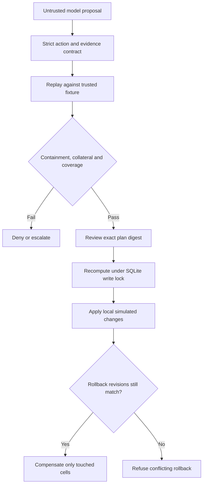

# AFTERSHOCK

### What breaks when your security response stops the attack?

**An executable lab for response collateral, untrusted AI proposals and conflict-aware rollback.**

An IP block can stop every malicious request in a replay and still deny hundreds of legitimate requests. A rollback can restore a control and accidentally erase another operator's work. AFTERSHOCK makes both failure modes visible and testable.

**[Start in Italian](START_HERE_IT.md)** · **[Research and prior art](docs/RESEARCH_IT.md)** · **[Architecture and trust boundaries](docs/DESIGN.md)** · **[Experiments](docs/EXPERIMENTS.md)**

## Run the demo

Python 3.10+, standard library only. Run from this repository's root:

```bash
python -m aftershock demo
python -m unittest discover -s tests -v
```

Open `output/index.html`. The prebuilt [DEMO.html](DEMO.html) contains the same experiment results and can be opened directly after downloading. No server, cloud account, API key, Docker or model download is needed for the default demo.

## A concrete result

Shared-egress fixture: **900 benign + 100 attack requests**.

| Proposed response | Attack requests newly denied | Benign requests newly denied | Default gate |
| --- | ---: | ---: | --- |
| Observe only | 0 / 100 | 0 / 900 | Denied: no containment |
| Block the source IP | 100 / 100 | 600 / 900 | Denied: collateral |
| Block sensitive file paths | 100 / 100 | 0 / 900 | Eligible for human review |
| Isolate store | 100 / 100 | 900 / 900 | Denied: collateral |
| Disable WAF | 0 / 100 | 0 / 900 | Denied: control integrity and containment |

These are exact outcomes of a **constructed simulation**, not production accuracy, prevented breaches, unique affected people, measured downtime or revenue estimates.

## Four scenarios, including cases with no acceptable answer

1. **Shared egress IP:** compare a broad IP block with a path control.
2. **Payment callback:** distinguish signed callbacks from synthetic invalid-signature requests; include downstream checkout dependency.
3. **Shared identity:** the action catalog cannot separate legitimate and malicious use; every effective response exceeds the loss budget.
4. **Missing ground truth:** an apparently precise rule also denies unknown traffic. Incomplete coverage prevents approval.

The HTML report lets you compare actions, inspect request witnesses, explore the collateral budget and step through two recorded SQLite rollback experiments. Moving the UI slider only explores eligibility; it never authorizes a write.

## Where AI fits

An optional local Ollama model can select an action and cite observations. It cannot submit arbitrary tools, write the database, alter policy, approve a plan or supply trusted outcome metrics. Ground-truth request labels are withheld from its prompt.

The default demo uses deterministic, handwritten proposal fixtures. **It does not run an LLM or measure prompt-injection attack success.** See [the optional local-model protocol](docs/OLLAMA.md) to collect actual clean/poisoned runs yourself.

## Approval and rollback are executable



- **Stale approvals:** any state revision change invalidates the prepared plan.
- **Scoped undo:** unrelated operator edits survive rollback.
- **Conflict detection:** a newer revision on a touched cell prevents the entire rollback, even if its value looks unchanged.
- **Atomicity:** multi-cell rollback checks all preconditions before writing; SQLite serializes writers.
- **Audit:** hash-linked events support consistency checks. An externally retained head is required to detect truncation. Hashes are not authentication or an immutable ledger.

All mutations affect only a selected local SQLite database. There are no real firewall, cloud, identity or EDR adapters.

## Explore the local transaction flow

```bash
python -m aftershock init
python -m aftershock plan --candidate narrow_control
```

Read `output/plan.json`, including the patch, evidence and evaluation. Copy its exact `plan_digest` into the next command:

```bash
python -m aftershock apply --approve PASTE_REVIEWED_DIGEST
python -m aftershock edit --key config:banner --value '"v2-operator-release"'
python -m aftershock rollback --transaction PASTE_TRANSACTION_ID
python -m aftershock audit
```

The banner survives. A same-control edit produces a conflict instead. The detailed [Italian walkthrough](START_HERE_IT.md) uses separate database paths for the two experiments. Approval digests are a local review binding, not an identity system or multi-user authorization service.

## Quality gate

The checked-in workflow runs unit/integration tests, Bandit medium/high checks and demo generation on Ubuntu and Windows. Runtime has no third-party dependencies; Bandit is a development dependency.

```bash
python -m venv .venv
# Git Bash on Windows:
source .venv/Scripts/activate
# Ubuntu alternative: source .venv/bin/activate
python -m pip install -r requirements-dev.txt
python -m unittest discover -s tests -v
python -m bandit -r aftershock -ll
```

See [verification status](docs/VERIFICATION.md) for what was actually run. Workflow configuration is not evidence of a successful remote Actions run and does not configure branch protection.

## Scope and honest limits

AFTERSHOCK is a small deterministic simulator, not a calibrated digital twin or a production SOAR. Its fixed workload does not model retries, latency, queueing, adaptive attackers, asynchronous external APIs or irreversible effects. A credential compromise cannot be undone by toggling a Boolean in reality. Fixture labels are known; real classification uncertainty is much harder.

The policy gate assumes trusted code, scenario definitions, policy and database ownership. A process that can edit those can bypass this lab. Evidence IDs validate reference existence, not the truth of an explanation. Control coverage is limited to the explicit action catalog.

## Originality and authorship

Counterfactual security-response evaluation, approval gates and compensating transactions have substantial prior art. This project does not claim to invent them. Its portfolio contribution is a compact, reproducible demonstration that connects **request-level collateral witnesses, abstention under uncertainty and revision-aware rollback**. The initial scaffold was prepared with AI assistance; the next step is to run, challenge and extend it with documented experiments. No fabricated development history or claimed production deployment is included.
